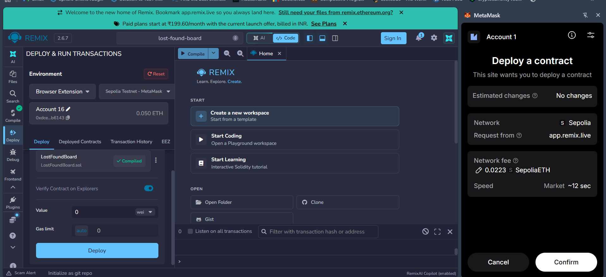
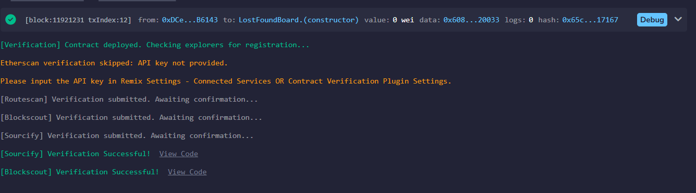
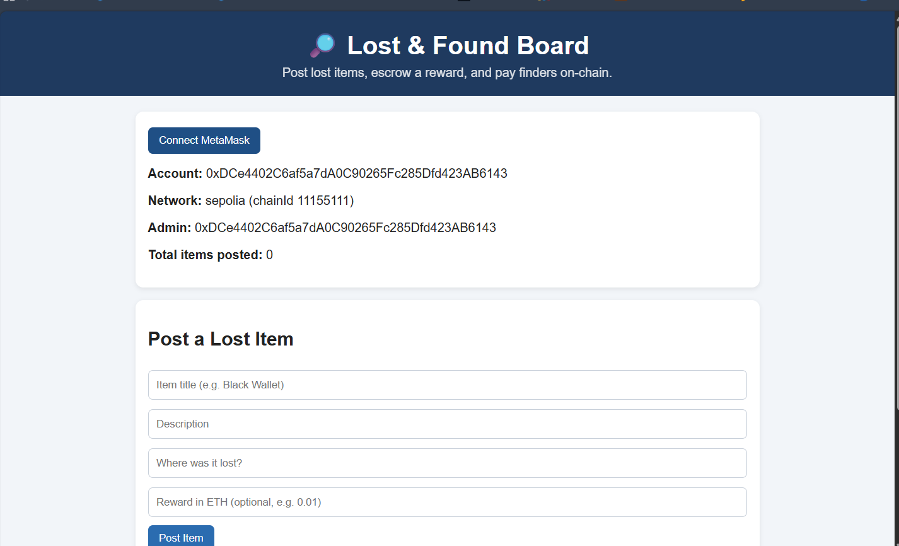
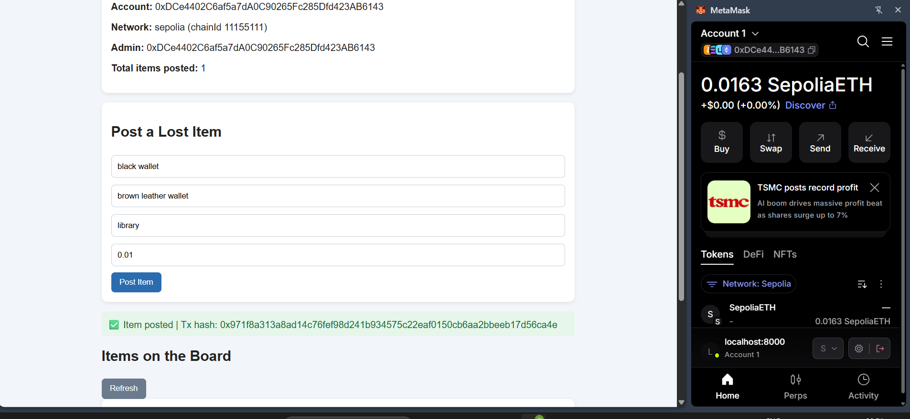
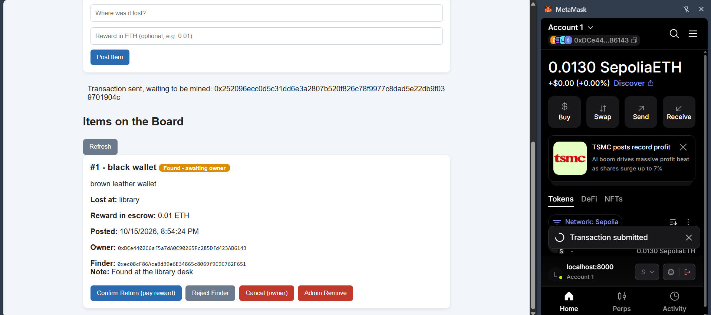
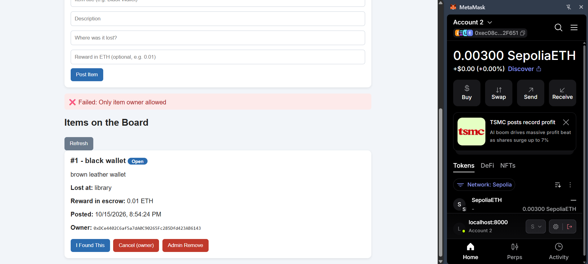
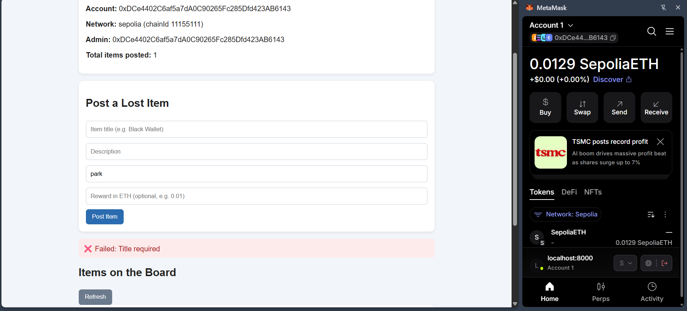
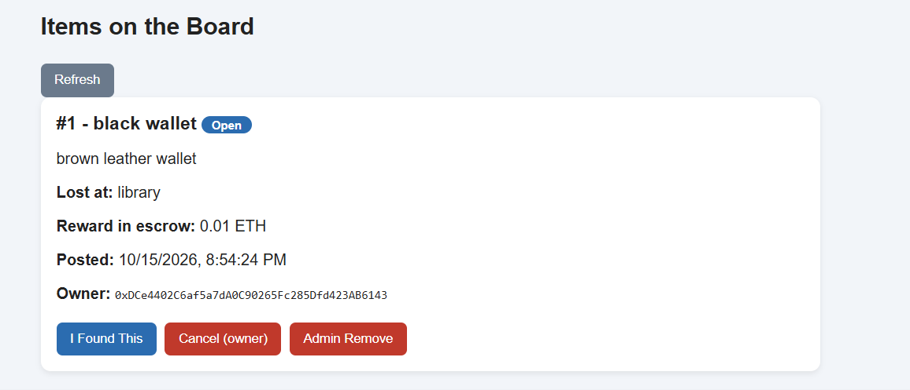

# Lost & Found Board DApp

**Course:** Blockchain Technology (CSE4444), Assignment 2
**Author:** [Your Full Name] ([Your Registration Number])

A decentralized Lost & Found board built with Solidity on the Ethereum Sepolia testnet. Owners post lost items and lock an ETH reward in the smart contract. Finders report the item, and the reward is released to the finder when the owner confirms the return.

---

## 1. Problem Statement

Lost items are usually reported on notice boards or social media with no trust or incentive. Owners cannot guarantee a reward, and finders cannot be sure they will be paid. This DApp solves that with an on-chain escrow:

1. The owner posts a lost item and (optionally) sends an ETH reward, which the contract holds.
2. A finder reports that they have the item and leaves a note on how to collect it.
3. The owner confirms the return and the contract automatically pays the reward to the finder.
4. The owner can reject a false report (the item reopens) or cancel the post (reward refunded). An admin can remove spam posts.

## 2. Tech Stack

| Component | Technology |
|---|---|
| Smart contract | Solidity ^0.8.20 |
| Compile / deploy | Remix IDE + MetaMask (Browser Extension) |
| Network | Sepolia Testnet (chain ID 11155111) |
| Frontend | HTML, CSS, JavaScript |
| Wallet / blockchain library | MetaMask + Ethers.js v5 |

## 3. Deployment Details

| Item | Value |
|---|---|
| Network | Sepolia Testnet (chain ID 11155111) |
| Contract address | `0x44c6212714c9711057baAA5dE2463Ad71bea0920` |
| Deployer / admin address | `0xDCe4402C6af5a7dA0C90265Fc285Dfd423AB6143` |
| Deployment tx hash | `0x830c55a8d16c0fa11772da2266ee9076f804f078eeb08d31eeb65329aff757f8` |
| Compiler | Solidity 0.8.20 |

View on Etherscan: `https://sepolia.etherscan.io/address/0xPASTE_CONTRACT_ADDRESS_HERE`

## 4. Project Structure

```
lost-found-dapp/
├── contracts/LostFoundBoard.sol
├── frontend/
│   ├── index.html
│   ├── style.css
│   ├── config.js
│   └── app.js
├── screenshots/
├── test-results/test-cases.md
├── deployment/deployment-details.md
├── .gitignore
└── README.md
```

## 5. Smart Contract Features

- **Constructor** sets the admin to the deployer.
- **State variables:** `admin`, `itemCount`, and a mapping of items (struct with owner, title, description, location, reward, finder, note, status, timestamp).
- **Enum** `Status { Open, FoundReported, Returned, Cancelled }`.
- **Functions:** `postItem`, `reportFound`, `confirmReturn`, `rejectFinder`, `cancelItem`, `adminRemoveItem`, `getItem`.
- **Validation (`require`):** title and location required, title length limit, valid item ID, note required, owner cannot report own item, status checks.
- **Access control (modifiers):** `onlyAdmin`, `onlyItemOwner`, `validId`.
- **Events** for every state change.
- **Safe payouts:** state is updated before ETH is transferred.

## 6. How to Run the Application

1. Clone this repository.
2. Open `frontend/config.js` and confirm `CONTRACT_ADDRESS` matches the deployed address in Section 3.
3. In a terminal, start a local web server from the `frontend` folder:
   ```
   cd frontend
   python3 -m http.server 8000
   ```
4. Open **http://localhost:8000** in a browser that has MetaMask installed (do not open the file directly or use `0.0.0.0`).

## 7. Connect MetaMask and Interact

1. Install MetaMask and switch the network to **Sepolia** (turn on "Show test networks" in settings). Get free test ETH from a Sepolia faucet.
2. On the page, click **Connect MetaMask** and approve the connection. The page shows your account, network, admin address and total items.
3. **Post an item:** enter title, description, location and an optional reward in ETH, click **Post Item**, and confirm in MetaMask.
4. **Report found:** switch to a second MetaMask account, click **I Found This** on an item, type a note and confirm.
5. **Confirm return:** switch back to the owner account and click **Confirm Return (pay reward)**. The reward is paid to the finder.
6. Owners can also **Reject Finder** or **Cancel** (refund). The admin can use **Admin Remove**.

> Note: if MetaMask shows the wrong network on the page, change the network for the `localhost:8000` site in MetaMask's connected-sites panel to Sepolia, then refresh.

---

## 8. Test Cases and Results

Accounts used: **Account 1** = owner and admin (`0xDCe4...B6143`), **Account 2** = finder (`0xec08...2F651`).

| # | Type | Account | Action | Expected | Observed |
|---|------|---------|--------|----------|----------|
| 1 | Valid | Account 1 | Post "black wallet", location "library", reward 0.01 ETH | Item #1 created, 0.01 ETH escrowed | Success. Item #1 Open, 0.01 ETH in escrow. Tx: `0x971f8a31...d56ca4e` |
| 2 | Valid | Account 2 | Click "I Found This" on #1 with note "Found at the library desk" | Status becomes Found | Success. Status "Found - awaiting owner", finder recorded. Tx: `0xb270566e...ab4e0d2` |
| 3 | Valid | Account 1 | Click "Confirm Return" on #1 | Reward paid to finder, status Returned | Success. Status "Returned", escrow 0.0 ETH, reward paid to Account 2. Tx: `0x252096ec...39701904c` |
| 4 | Invalid | Account 1 | Post item with empty title | Rejected: "Title required" | Rejected. Red message "Failed: Title required", no gas spent |
| 5 | Invalid | Account 2 | Report found with an empty note | Reverts (note required) | Transaction mined and reverted. UI shows "transaction failed" |
| 6 | Unauthorized | Account 2 | Click "Cancel (owner)" on Account 1's item #1 | Rejected: "Only item owner allowed" | Rejected. Red message "Failed: Only item owner allowed", item unchanged |

---

## 9. Screenshots

### 9.1 Smart Contract Compilation
<!-- SCREENSHOT 1: Remix "Solidity Compiler" tab showing LostFoundBoard.sol compiled with the green tick -->


### 9.2 Smart Contract Deployment
<!-- SCREENSHOT 2: Remix terminal showing the constructor deployment with the green tick -->


### 9.3 MetaMask Wallet Connection
<!-- SCREENSHOT 3: The web page showing Account, Network (sepolia), Admin and Total items filled in, ideally with the MetaMask panel beside it -->


### 9.4 Successful Transactions
<!-- SCREENSHOT 4: Green "Item posted | Tx hash" message on the page -->
**Post item (Account 1):**


<!-- SCREENSHOT 4b: Green "Found report submitted" message and item showing "Found - awaiting owner" -->
**Report found (Account 2):**



### 9.5 Failed Transactions
<!-- SCREENSHOT 5: Red "Failed: Only item owner allowed" message (Account 2 cancelling Account 1's item) -->
**Unauthorized action:**



<!-- SCREENSHOT 5c: Red "Failed: Title required" message with the title field empty -->
**Invalid input:**


### 9.6 Blockchain Data Displayed Through the User Interface
<!-- SCREENSHOT 6: An item card showing title, description, location, reward in escrow, posted time, owner, status -->


---

## 10. Security Note

No private keys, seed phrases, passwords or other credentials are stored in this repository. The contract address and wallet addresses shown are public testnet addresses.
